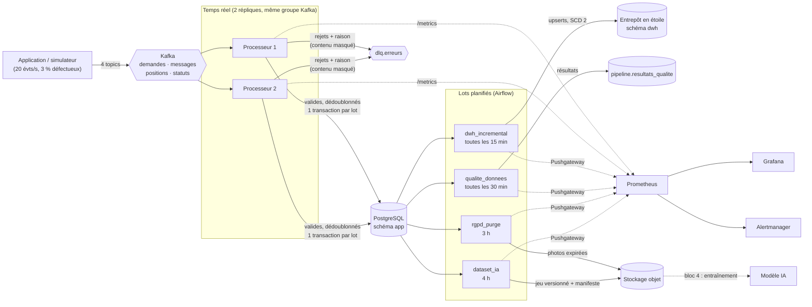

# Architecture des pipelines

## 1. Vue d'ensemble

## 2. Le flux temps réel, étape par étape

| Étape | Ce qui se passe | Pourquoi |
|---|---|---|
| 1. Lecture | Lot de 500 messages au plus (ou 1 s) | Compromis débit / latence |
| 2. Validation | Contrat Pydantic par type d'événement : champs, types, valeurs autorisées, date plausible, coordonnées en Île-de-France | Une donnée invalide n'entre jamais en base |
| 3. Idempotence | Chaque `event_id` est inscrit dans `pipeline.evenements_traites` **dans la même transaction** que la donnée | Un événement rejoué (redémarrage, double envoi) n'est jamais écrit deux fois |
| 4. Intégrité | Le client possède-t-il ce logement ? La demande existe-t-elle ? L'artisan est-il actif ? La transition d'état est-elle permise ? | Les contraintes métier sont vérifiées avant l'écriture |
| 5. Écriture | Une transaction par lot | Tout ou rien |
| 6. Rejets | Envoi dans `dlq.erreurs` avec la raison en en-tête et le contenu **masqué** | Rien n'est perdu, tout est analysable ; minimisation RGPD |
| 7. Validation Kafka | Offsets validés **après** le commit en base | Un crash entre deux étapes fait rejouer le lot : pas de perte |

### Gestion des erreurs et reprise automatique

| Situation | Comportement |
|---|---|
| Événement mal formé | Rejeté en DLQ (`json_invalide`, `schema_invalide`) ; le flux continue |
| Référence inconnue, transition impossible | Rejeté en DLQ (`reference_inconnue`, `transition_invalide`) |
| Une ligne viole une contrainte de la base | Le lot est rejoué **ligne par ligne** : seule la ligne fautive part en DLQ (`contrainte_base`) ; le flux ne se bloque jamais sur un « lot empoisonné » |
| Base indisponible | 6 nouvelles tentatives avec attente croissante (2, 4, 8… s) ; ensuite arrêt du processus, redémarrage par Docker, reprise au dernier offset validé |
| Un processeur tombe | Kafka redonne ses partitions au second processeur en quelques secondes (`scripts/demo_redondance.sh`) |
| Tâche Airflow en échec | 3 nouvelles tentatives (1, 2, 4 min) ; après la dernière : métrique d'échec → alerte `TacheAirflowEnEchec` |
| Rechargement de l'entrepôt | Upserts et fenêtre glissante : relancer un chargement ne crée jamais de doublon |

## 3. Performances mesurées

| Indicateur | Valeur mesurée | Objectif (cahier des charges, bloc 2) |
|---|---|---|
| Débit maximal (banc d'essai `benchmark`, 20 000 événements) | **~10 000 événements/s** de bout en bout | 200/s en pointe |
| Latence en régime normal (20 évts/s) | **p50 0,5 s, p95 1 s** | moins de 5 s |
| Chargement incrémental de l'entrepôt | < 1 s par exécution | toutes les 15 min |
| Contrôles qualité (9 règles, ~38 000 lignes) | < 1 s | toutes les 30 min |

## 4. Qualité des données

Les 9 règles reprennent les 6 dimensions du plan de gouvernance (bloc 1, §6) :

| Règle | Dimension | Seuil |
|---|---|---|
| `demandes_completes` | exhaustivité | 99 % |
| `adresses_valides` | exactitude | 98 % |
| `clients_sans_doublon` | unicité | 99,5 % |
| `devis_valides` | validité | 99,5 % |
| `assurances_a_jour` | fraîcheur | 98 % |
| `flux_temps_reel_frais` | fraîcheur | 100 % |
| `factures_coherentes` | cohérence | 99,9 % |
| `interventions_terminees_datees` | cohérence | 100 % |
| `entrepot_complet` | cohérence | 99 % |

### Anomalies réellement détectées

1. **`assurances_a_jour` (94,9 %)** — 16 artisans actifs ont une assurance décennale expirée.
   → Action métier : le Data Steward « Réseau artisans » les relance ; sans renouvellement sous 15 jours, ils sont suspendus.
2. **`factures_coherentes` (93,5 %)** — écart d'**un centime** entre le devis et la facture sur 6,5 % des factures, toutes
   à TVA 5,5 %. Cause : le devis arrondit « au demi supérieur » (fonction `round` de PostgreSQL), la facturation arrondit
   « au pair » (arrondi bancaire, `Decimal.quantize`).
   → Correction : aligner la facturation sur l'arrondi au demi supérieur (`ROUND_HALF_UP`), puis corriger l'historique.

Ces deux cas montrent l'intérêt des contrôles : ils signalent sans bloquer le flux, et chaque anomalie a un responsable.

## 5. RGPD dans le pipeline

| Exigence | Mise en œuvre |
|---|---|
| Minimisation | Les textes exportés pour l'IA et le contenu de la DLQ sont **masqués** (téléphones, emails, IBAN) ; l'entrepôt ne contient aucun identifiant direct |
| Sécurité | TLS vers PostgreSQL, compte `pipeline_etl` sans accès aux données de santé, identité S3 limitée aux buckets `photos` et `datasets`, secrets hors du code |
| Droit d'opposition | Les clients opposés à l'entraînement de l'IA sont exclus du jeu d'entraînement (212 demandes exclues sur la dernière version) |
| Durées de conservation | DAG `artelio_rgpd_purge` chaque nuit : base + photos dans S3 |
| Traçabilité | `pipeline.journal_executions` (qui a lu/écrit quoi, quand) ; manifeste SHA-256 de chaque jeu publié ; journal d'audit de la base |
| Violations | Le DAG qualité appelle `audit.detecter_anomalies()` : une modification massive inhabituelle déclenche l'alerte critique `SuspicionDeViolation` (procédure de notification CNIL sous 72 h) |

## 6. Limites connues

| Limite | Évolution prévue |
|---|---|
| La DLQ est consultée à la main (`kafka-console-consumer`) | Petit outil de rejeu après correction |
| Garantie « au moins une fois » sur la DLQ (un rejet peut y figurer deux fois après un crash) | Sans conséquence : la DLQ sert à l'analyse, pas au calcul |
| Airflow en `LocalExecutor` sur un seul nœud | `CeleryExecutor` ou `KubernetesExecutor` si le nombre de DAG augmente |
